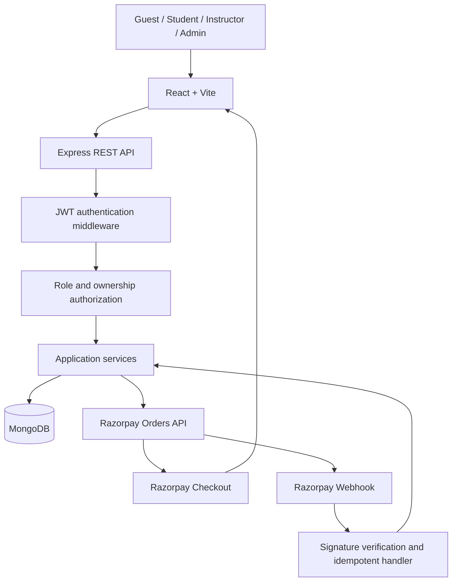

# LMS — System Architecture

**Status:** Proposed greenfield architecture. Confirm decisions before implementation.

## 1. Architecture goals

- React client separated from Express REST API.
- MongoDB accessed through Mongoose models/repositories.
- JWT authentication and bcrypt password hashing; no Clerk.
- Razorpay payment creation and verification on the backend.
- Clear module boundaries for parallel development.
- Shared team context stored in GitHub repository docs and GitHub Issues/PRs.

## 2. High-level architecture



## 3. Technology baseline

| Layer | Technology | Responsibility |
|---|---|---|
| Frontend | React + Vite + JavaScript | Public pages, dashboards, learning UI |
| Styling | CSS or Tailwind CSS | Responsive UI; choose one baseline |
| Routing | React Router | Client navigation and route guards |
| API client | Fetch or Axios | Communicate with backend |
| Backend | Node.js + Express | REST API and business logic |
| Database | MongoDB + Mongoose | Persistent application data |
| Authentication | JWT + bcrypt | Identity sessions and password hashing |
| Payment | Razorpay Node SDK/API | Orders, payment verification, webhooks |
| Testing | Vitest/React Testing Library, Jest or Node test tooling, Supertest | Tests; choose compatible tools during setup |
| Collaboration | GitHub Issues, Projects, PRs | Task and review workflow |
| AI tooling | GitHub MCP + Antigravity | AI-assisted GitHub access and coding |
| Lifecycle | AIDLC | Requirements, design, implementation, testing, deployment |

Do not add Strapi, Clerk, Firebase, or another backend platform.

## 4. Suggested repository structure

```text
lms/
├── client/
│   ├── src/
│   │   ├── app/
│   │   ├── components/
│   │   ├── features/
│   │   │   ├── auth/
│   │   │   ├── courses/
│   │   │   ├── enrollment/
│   │   │   ├── learning/
│   │   │   ├── instructor/
│   │   │   └── admin/
│   │   ├── pages/
│   │   ├── services/
│   │   ├── hooks/
│   │   └── utils/
│   └── package.json
├── server/
│   ├── src/
│   │   ├── config/
│   │   ├── middleware/
│   │   ├── modules/
│   │   │   ├── auth/
│   │   │   ├── users/
│   │   │   ├── courses/
│   │   │   ├── lessons/
│   │   │   ├── payments/
│   │   │   ├── enrollments/
│   │   │   └── progress/
│   │   ├── utils/
│   │   └── app.js
│   └── package.json
├── docs/
├── .github/
└── README.md
```

This is a target structure, not permission to generate the whole codebase before the AIDLC design/approval step.

## 5. Backend module boundaries

Each module should own its routes, controller, service, validation, and model where appropriate. Keep controllers focused on HTTP concerns and services focused on business rules.

- `auth`: registration, login, token/session lifecycle.
- `users`: profile and role administration.
- `courses`: catalogue, course CRUD, publishing workflow.
- `lessons`: sections and lesson content access.
- `payments`: order creation, signature verification, webhook handling.
- `enrollments`: enrollment lifecycle and access eligibility.
- `progress`: lesson completion and course progress.

## 6. Security architecture

- Hash passwords with bcrypt; never store plaintext passwords.
- Sign JWTs with a strong secret from environment configuration; validate issuer/audience/expiry as applicable.
- Decide and document token storage strategy. Prefer secure, HttpOnly, Secure, SameSite cookies where the deployment architecture supports them; protect cookie-based state-changing requests against CSRF. If bearer tokens are used, document secure storage and refresh/revocation strategy; do not put long-lived secrets in localStorage by default.
- Apply rate limits to login, registration, and sensitive endpoints.
- Validate request bodies, params, and query values.
- Enforce roles, ownership, enrollment, and course publication rules on the backend.
- Never trust client-submitted course price, user role, payment status, or enrollment status.
- Create Razorpay orders on the server using the database price.
- Verify checkout signature on the server using the Razorpay secret and constant-time comparison where appropriate.
- Verify webhook signature against the exact raw request body using the webhook secret.
- Make webhook handling idempotent and persist provider event/payment/order identifiers with unique constraints where appropriate.
- Keep secrets in environment variables/secret manager; commit only placeholder `.env.example`.
- Do not log credentials, JWTs, payment secrets, or sensitive personal data.

## 7. Payment and enrollment flow

1. Authenticated student requests purchase for a course.
2. Backend loads course and authoritative price from MongoDB.
3. Backend creates Razorpay order and stores a pending payment/order record.
4. Frontend opens Razorpay Checkout using the returned order details and public key ID.
5. Frontend sends payment identifiers/signature to backend for verification.
6. Backend verifies signature and records the verified result.
7. Razorpay webhook is independently signature-verified and handled idempotently.
8. Enrollment is activated only after trusted server-side confirmation according to the approved payment state machine.
9. Client fetches enrollment status from backend.

Do not activate enrollment from a frontend success callback alone. Define reconciliation behavior for delayed webhooks, duplicate events, failed payments, and refunds before production.

## 8. API conventions

- Use a consistent `/api/v1` prefix unless an approved alternative is chosen.
- Use JSON request/response bodies.
- Use correct HTTP status codes.
- Centralize error handling.
- Document authentication and role requirements per endpoint.
- Add pagination and filtering for list endpoints.
- Version and review API contracts before parallel frontend/backend implementation.

## 9. Deployment

Provider is undecided. Keep frontend, backend, MongoDB, Razorpay, and email/media services independently configurable. Document production domains, CORS, callback URLs, webhook URL, health checks, secrets, build commands, and rollback plan before release.
